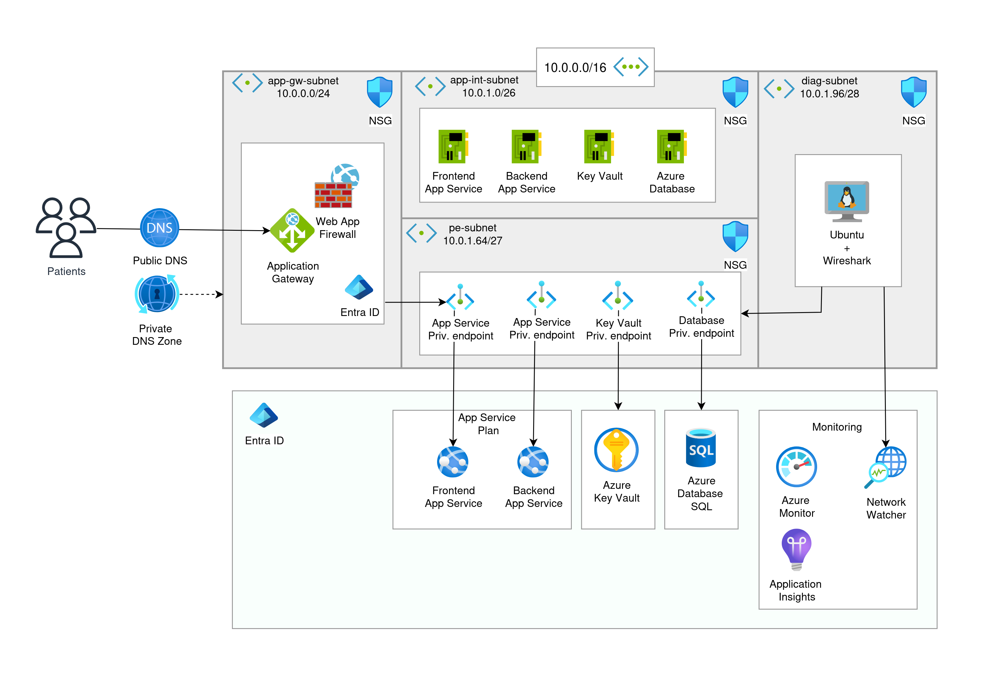
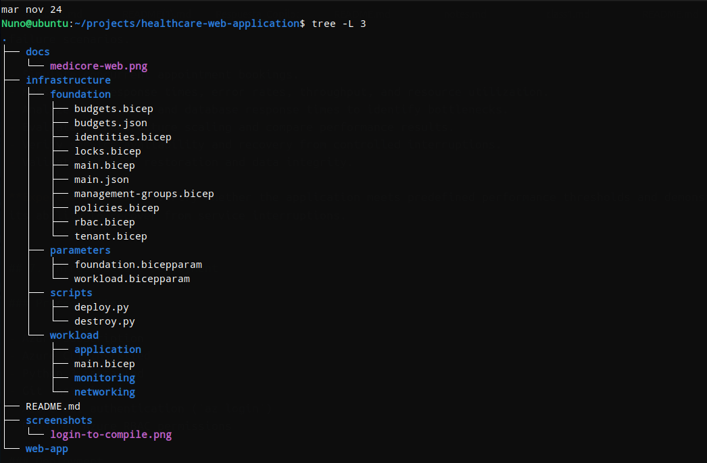

# Azure Healthcare Web Application


## 1. Project Context

MediCore Health is a private clinic with a web portal hosted on a local server, where patients can explore medical specialties and book appointments. To simplify updates, scale resources based on demand, and improve service monitoring, the clinic has decided to move its infrastructure to Microsoft Azure.

Booking an appointment involves multiple network connections, protocols, and services. Connectivity issues, security problems, or database access failures can interrupt this process. The IT team needs to analyze end-to-end communications, identify the root cause of incidents, and verify that the issues have been resolved.


## 2. Project Objectives

1. Deploy and manage the resources needed to host a web application and its database.
2. Configure and validate DNS and network connectivity, manage TLS certificates, implement network segmentation, and control access.
3. Analyze an end-to-end transaction by capturing network traffic with Wireshark and examining the protocols involved in the communication.
4. Implement logs, metrics, traces, and alerts, and reproduce incidents to investigate their causes.
5. Automate application updates using CI/CD pipelines. Export Azure configurations to Bicep templates to deploy and remove infrastructure automatically, reducing costs.
6. Simulate high-demand periods through load testing, monitor response times and resource usage, and identify potential bottlenecks.


## 3. Architecture of MediCore Health



> Design of architecture of MediCore Health in Microsoft Azure

The architecture uses a Virtual Network (VNet) with four separate subnets:

- **appgw-subnet:** Hosts Application Gateway and Web Application Firewall (WAF).
- **app-int-subnet:** Enables outbound connections from App Service to private resources.
- **pe-subnet:** Provides private access to App Services, Azure SQL Database, and Key Vault through Private Endpoints.
- **diag-subnet:** Hosts a Linux VM for network traffic analysis and troubleshooting.


## 4. MediCore Health structure



~/projects/healthcare-web-application$ tree -L 3
.
├── docs
│   └── medicore-web.png
├── infrastructure
│   ├── foundation
│   │   ├── budgets.bicep
│   │   ├── budgets.json
│   │   ├── identities.bicep
│   │   ├── locks.bicep
│   │   ├── main.bicep
│   │   ├── main.json
│   │   ├── management-groups.bicep
│   │   ├── policies.bicep
│   │   ├── rbac.bicep
│   │   └── tenant.bicep
│   ├── parameters
│   │   ├── foundation.bicepparam
│   │   └── workload.bicepparam
│   ├── scripts
│   │   ├── deploy.py
│   │   └── destroy.py
│   └── workload
│       ├── application
│       ├── main.bicep
│       ├── monitoring
│       └── networking
├── README.md
├── screenshots
│   └── structure-of-project.png
└── web-app


## 5. Security & End-to-End Communication Analysis

Validate network connectivity and security controls while analyzing an appointment booking transaction from the client to the database.

- Validate network connectivity and security controls while analyzing an appointment booking transaction from the client to the database.
- Verify DNS resolution, TCP connections, TLS encryption, and HTTP communication.
- Validate network segmentation, NSG rules, and private connectivity.
- Test authorized and unauthorized access to protected resources.
- Verify RBAC permissions, managed identities, and secure access to secrets.
- Capture network traffic with Wireshark and correlate it with application logs and traces.
- Reconstruct an end-to-end appointment booking transaction and identify communication dependencies.

Expected results: 


## 6. Automated Deployment & Application Updates

Automate infrastructure provisioning and application deployments using Bicep, Python scripts, and GitHub Actions.

- Provision and configure Azure resources using Infrastructure as Code (IaC).
- Build, test, and deploy application updates through CI/CD pipelines.
- Deploy a new application version using deployment slots.
- Validate the update and perform a rollback if necessary.

**Expected results:** Verify that infrastructure deployments are reproducible and application updates do not interrupt the service.


## 7. Performance & Availability Testing

Evaluate application performance, scalability, and service availability under controlled workloads and failure scenarios.

- Simulate concurrent appointment bookings.
- Measure p95 response times, error rates, throughput, and resource utilization.
- Analyze application and database response times to identify bottlenecks.
- Evaluate infrastructure scaling and compare performance results.
- Verify service availability and recovery from controlled interruptions.
- Validate database restoration and data integrity.

**Expected results:** Verify whether the application meets predefined performance thresholds and demonstrate its ability to recover from service interruptions.


## 8. Infrastructure Deployment 

### Prerequisites

- Azure subscription
- Azure CLI installed
- Python 3 installed
- Git installed
- Azure CLI authentication (`az login`)
- Required Azure RBAC permissions

### Deployment

```
python deploy.py
```
### Destroy infrastructure

```
python destroy.py
```


## 9. References

- Dignitae. AZ-104T00-A Microsoft Knowledge and Skills with Challenge Labs. Training material<br>

- Microsoft. Course AZ-104T00-A: Microsoft Azure Administrator. Microsoft Learn<br>
https://learn.microsoft.com/en-us/training/courses/az-104t00

- Microsoft. Training for Administrators. Microsoft Learn<br> 
https://learn.microsoft.com/en-us/plans/50nrtozg28d354

- Microsoft. Basic web application. Architecture Center<br>
https://learn.microsoft.com/en-us/azure/architecture/web-apps/app-service/architectures/basic-web-app

- Microsoft. Baseline highly available zone-redundant web application. Architecture Center<br>
https://learn.microsoft.com/en-us/azure/architecture/web-apps/app-service/architectures/baseline-zone-redundant

- Microsoft. Configuración de una aplicación de App Service Microsoft Learn<br>
https://learn.microsoft.com/en-us/azure/app-service/configure-common

- Microsoft. Secure your Azure App Service deployment Microsoft Learn<br>
https://learn.microsoft.com/en-us/azure/app-service/overview-security

- GitHub. azure-quickstart-templates<br>
https://github.com/Azure/azure-quickstart-templates

- Microsoft. Bicep documentation.<br>
https://learn.microsoft.com/en-us/azure/azure-resource-manager/bicep/install

- Microsoft. Delete Azure resources at scale using a script. Azure CLI<br>
https://learn.microsoft.com/en-us/cli/azure/get-started-tutorial-4-delete-resources?view=azure-cli-latest&tabs=bash


